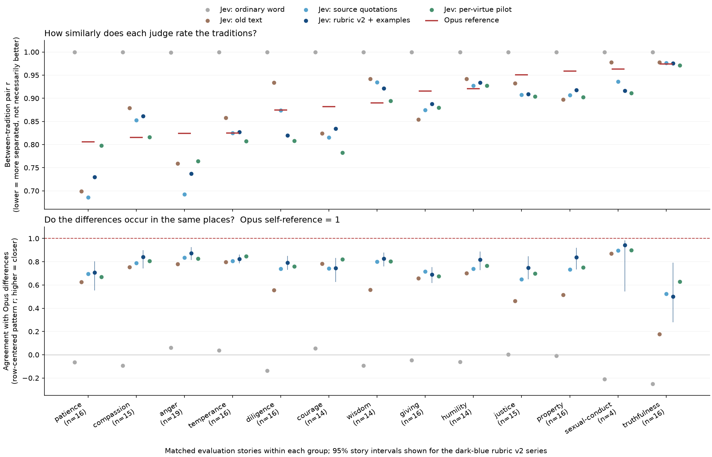

# Do source-supported differences survive teaching to Jev?

Opus 5.5 supervisor's [overall judgement](verdicts.md#overall-judgement), from the targeted disagreement review:

> The new rubrics do what the goal asks in most groups: Jev's differences between traditions move to where Opus's are (same-pattern r rises from old text in 12 of 13 groups, `table.md`), and the ordinary-word control fails everywhere. Of the 39 stories read (counting each story's flagged virtue), Jev is right in 6, both are defensible in 4, they agree in 14, Opus is right in 14, and both are wrong in 1. These are the worst-disagreement stories, selected to find errors, so they do not estimate an error rate. Jev's errors fall into four classes: (1) crediting "resists this vice" when the vice is not in play (reduced by a third in loop 4, not gone); (2) missing tradition-specific world knowledge (the Islamic Law on wine, the archaic Legge line); (3) not inferring motive (a "gift" that is a bribe); (4) over-strong scores, which make Jev separate traditions somewhat more than Opus (pair-r gaps in patience, diligence, justice and property just exclude 0). Courage is the one group where rubric v2 did not beat the old text. Sexual conduct has only 4 stories, so it is not testable.

Run `just rubric-report` to rebuild this page and `figure.png` from saved scores, without model calls. Rows use the same stories and virtue order in every condition. Rubric v2 with examples uses loop 4; the earlier twelve-group input is loop 2 and wisdom is loop 3. The ordinary-word, old-text and quotation matrices and all Opus references are checked to be unchanged.

Pair r is correlation between traditions within one judge, averaged over cross-tradition item pairs only. Lower means more separation, not automatically better judgment. The signed gap is latest Jev pair r minus Opus pair r. Pattern r removes each story's mean before comparing Jev with Opus, so higher means the differences occur in similar places. Opus is a fallible reference, not moral truth. Its self-pattern correlation of 1 is the ideal reference ceiling; the ordinary-word control is the comparison floor. Neither establishes calibrated accuracy.

| Group (stories)    |   Opus pair r ± SD |   Jev pair r: word → old → quotes → rubric v2 |                      Gap [95%]→0 |   Pattern r: old → quotes → rubric v2↑ | Finding (Opus source review)                                                                                                                                                                          |
|:-------------------|-------------------:|----------------------------------------------:|---------------------------------:|---------------------------------------:|:------------------------------------------------------------------------------------------------------------------------------------------------------------------------------------------------------|
| patience (16)      |      0.806 ± 0.105 |                 0.999 → 0.699 → 0.686 → 0.730 |          -0.076 [-0.167, -0.003] |                  0.625 → 0.695 → 0.706 | [distinction supported by source; Jev separates it more than Opus (pair-r gap −.08 [−.17, −.00]).](verdicts.md#patience-meanings-differ-islamic-patience-includes-constancy-in-right-endeavour)       |
| compassion (15)    |      0.815 ± 0.145 |                 1.000 → 0.879 → 0.853 → 0.861 |          +0.046 [-0.028, +0.113] |                  0.754 → 0.789 → 0.842 | [passed.](verdicts.md#compassion-meanings-differ-hindu-non-killing-is-universal-taoist-compassion-joined-to-battle)                                                                                   |
| anger (19)         |      0.824 ± 0.117 |                 0.999 → 0.759 → 0.693 → 0.737 |          -0.087 [-0.193, +0.026] |                  0.779 → 0.836 → 0.874 | [distinction supported.](verdicts.md#anger-meanings-differ-feeling-arises--restrained--revenge--speech-manner--ill-will)                                                                              |
| temperance (16)    |      0.825 ± 0.145 |                 1.000 → 0.858 → 0.825 → 0.827 |          +0.002 [-0.051, +0.042] |                  0.798 → 0.805 → 0.824 | [passed.](verdicts.md#temperance-meanings-differ-islamic-appetite-under-the-law-christian-food-and-drink-only)                                                                                        |
| diligence (16)     |      0.875 ± 0.125 |                 1.000 → 0.934 → 0.873 → 0.820 |          -0.055 [-0.115, -0.001] |                  0.555 → 0.739 → 0.791 | [unresolved; pattern improved (.56→.79), Jev separates slightly more than Opus.](verdicts.md#diligence-meanings-differ-christian-fervour-in-gods-service-luzzattos-zeal-for-mitzvot)                  |
| courage (14)       |      0.882 ± 0.073 |                 1.000 → 0.824 → 0.815 → 0.834 |          -0.048 [-0.141, +0.005] |                  0.784 → 0.742 → 0.745 | [unresolved; rubric v2 did not beat the old text (.78→.75).](verdicts.md#courage-meanings-differ-stoic-endurance-jewish-might--self-conquest-buddhist-energy-for-others-welfare)                      |
| wisdom (14)        |      0.890 ± 0.064 |                 1.000 → 0.942 → 0.935 → 0.921 |          +0.031 [-0.006, +0.084] |                  0.558 → 0.800 → 0.825 | [passed (.56→.83).](verdicts.md#wisdom-meanings-differ-confucian-wisdom--knowing-and-keeping-family-duties)                                                                                           |
| giving (16)        |      0.916 ± 0.054 |                 1.000 → 0.854 → 0.875 → 0.888 |          -0.028 [-0.071, +0.020] |                  0.657 → 0.716 → 0.689 | [passed on the pair-r test; pattern only .66→.69.](verdicts.md#giving-meanings-differ-ciceros-harmful-gift-limit-taoist-no-regret-buddhist-relinquishment)                                            |
| humility (14)      |      0.921 ± 0.052 |                 1.000 → 0.942 → 0.927 → 0.934 |          +0.013 [-0.024, +0.080] |                  0.700 → 0.739 → 0.818 | [distinction supported; one Jev reading error.](verdicts.md#humility-meanings-differ-rationalist-error-anticipation-vs-self-abasement)                                                                |
| justice (15)       |      0.950 ± 0.026 |                 1.000 → 0.932 → 0.908 → 0.909 |          -0.042 [-0.099, -0.001] |                  0.463 → 0.649 → 0.746 | [unresolved; pattern much improved (.46→.75), Jev separates slightly more than Opus.](verdicts.md#justice-meanings-differ-stoic-just-deserts-vs-islamic-al-munkar-vs-hindu-appropriation)             |
| property (16)      |      0.958 ± 0.023 |                 0.999 → 0.897 → 0.907 → 0.918 |          -0.040 [-0.116, -0.004] |                  0.515 → 0.734 → 0.838 | [unresolved; pattern much improved (.52→.84), Jev separates slightly more than Opus.](verdicts.md#property-meanings-differ-christian-restitutionusury-vs-taoist-housebreaking)                        |
| sexual-conduct (4) |      0.963 ± 0.035 |                 1.000 → 0.978 → 0.936 → 0.917 | -0.047 undefined (80/5000 draws) |                  0.869 → 0.897 → 0.943 | [distinction supported but untestable statistically (4 stories).](verdicts.md#sexual-conduct-meanings-partly-differ-thought-vs-bodily-act)                                                            |
| truthfulness (16)  |      0.974 ± 0.024 |                 1.000 → 0.978 → 0.976 → 0.976 |          +0.002 [-0.014, +0.035] |                  0.177 → 0.522 → 0.502 | [distinction partly supported; Opus barely separates the traditions here (pair r .97), so there is little to match.](verdicts.md#truthfulness-meanings-differ-speech-vs-certainty-vs-promise-keeping) |

SD is variation between virtue pairs, not a standard error. Intervals use 5,000 jointly resampled story rows, seed 20261022; they do not measure repeat-call noise or a representative population. Related stories can make them optimistic. Undefined draws invalidate an interval rather than being dropped; sexual conduct has only four stories. Groups are ordered by Opus pair r, most separation first, not by judgment quality. Findings are the attributed source review, not a blanket acceptance of all virtues.

### Same-pattern intervals and the ordinary-word control

| Group          |   Rubric v2 pattern r [95%]↑ |   Word pattern r |
|:---------------|-----------------------------:|-----------------:|
| patience       |       0.706 [+0.553, +0.802] |           -0.065 |
| compassion     |       0.842 [+0.743, +0.900] |           -0.093 |
| anger          |       0.874 [+0.815, +0.925] |            0.060 |
| temperance     |       0.824 [+0.787, +0.860] |            0.037 |
| diligence      |       0.791 [+0.731, +0.849] |           -0.136 |
| courage        |       0.745 [+0.627, +0.831] |            0.054 |
| wisdom         |       0.825 [+0.758, +0.879] |           -0.092 |
| giving         |       0.689 [+0.618, +0.755] |           -0.048 |
| humility       |       0.818 [+0.728, +0.888] |           -0.061 |
| justice        |       0.746 [+0.650, +0.846] |            0.002 |
| property       |       0.838 [+0.734, +0.921] |           -0.010 |
| sexual-conduct |       0.943 [+0.545, +0.984] |           -0.211 |
| truthfulness   |       0.502 [+0.279, +0.790] |           -0.251 |

## Short-example per-virtue pilot

This is a separate short-example, forward-view condition, not a replacement for the two-view one-request-per-story rows above. The figure labels it separately. All scored passages remain frozen; this report does not substitute current source repairs. Alone/order ratios divide the mean absolute shift by fresh-repeat noise; both must be at most 1.5. The short-diagnostic check uses the stricter 1.0 ratio and has failures. One repeat is not a noise distribution.

| Group          |   Pair r |       Pattern r [95%]↑ |   Alone / order ratios↓ | Independence   | Short diagnostic   |
|:---------------|---------:|-----------------------:|------------------------:|:---------------|:-------------------|
| patience       |    0.798 | 0.668 [+0.520, +0.779] |           1.374 / 1.152 | pass           | FAIL               |
| compassion     |    0.816 | 0.805 [+0.652, +0.888] |           0.933 / 0.972 | pass           | pass               |
| anger          |    0.764 | 0.827 [+0.700, +0.905] |           1.084 / 1.074 | pass           | FAIL               |
| temperance     |    0.807 | 0.847 [+0.811, +0.878] |           1.022 / 1.214 | pass           | FAIL               |
| diligence      |    0.808 | 0.760 [+0.687, +0.837] |           0.878 / 0.933 | pass           | pass               |
| courage        |    0.782 | 0.821 [+0.756, +0.878] |           0.930 / 1.050 | pass           | pass               |
| wisdom         |    0.894 | 0.803 [+0.742, +0.850] |           0.957 / 1.073 | pass           | FAIL               |
| giving         |    0.880 | 0.675 [+0.527, +0.798] |           0.910 / 0.922 | pass           | pass               |
| humility       |    0.927 | 0.767 [+0.601, +0.878] |           0.789 / 1.042 | pass           | FAIL               |
| justice        |    0.904 | 0.697 [+0.593, +0.809] |           0.832 / 1.023 | pass           | pass               |
| property       |    0.902 | 0.752 [+0.590, +0.881] |           0.833 / 0.809 | pass           | pass               |
| sexual-conduct |    0.911 | 0.900 [+0.327, +0.979] |           0.943 / 0.955 | pass           | pass               |
| truthfulness   |    0.971 | 0.629 [+0.481, +0.843] |           0.984 / 1.212 | pass           | FAIL               |

The short diagnostic omits full passages and criteria from its own review. Its selected `missing` word is collected feedback, not absent feedback. Neither a small scored shift nor a `none` diagnostic establishes feedback equivalence. Wassname approved five-level rubric v2 for the 80 major virtues with a full feedback copy once per story version and short copies elsewhere. That hybrid is a deliberate visibility/cost tradeoff, not a finding that the two diagnostics are equivalent.

## Source judgments and meanings by group

### patience

[Supervisor verdicts](verdicts.md#patience-meanings-differ-islamic-patience-includes-constancy-in-right-endeavour) · [Source scope, quotation and limits](meanings.md#patience).

### compassion

[Supervisor verdicts](verdicts.md#compassion-meanings-differ-hindu-non-killing-is-universal-taoist-compassion-joined-to-battle) · [Source scope, quotation and limits](meanings.md#compassion).

### anger

[Supervisor verdicts](verdicts.md#anger-meanings-differ-feeling-arises--restrained--revenge--speech-manner--ill-will) · [Source scope, quotation and limits](meanings.md#anger).

### temperance

[Supervisor verdicts](verdicts.md#temperance-meanings-differ-islamic-appetite-under-the-law-christian-food-and-drink-only) · [Source scope, quotation and limits](meanings.md#temperance).

### diligence

[Supervisor verdicts](verdicts.md#diligence-meanings-differ-christian-fervour-in-gods-service-luzzattos-zeal-for-mitzvot) · [Source scope, quotation and limits](meanings.md#diligence).

### courage

[Supervisor verdicts](verdicts.md#courage-meanings-differ-stoic-endurance-jewish-might--self-conquest-buddhist-energy-for-others-welfare) · [Source scope, quotation and limits](meanings.md#courage).

### wisdom

[Supervisor verdicts](verdicts.md#wisdom-meanings-differ-confucian-wisdom--knowing-and-keeping-family-duties) · [Source scope, quotation and limits](meanings.md#wisdom).

### giving

[Supervisor verdicts](verdicts.md#giving-meanings-differ-ciceros-harmful-gift-limit-taoist-no-regret-buddhist-relinquishment) · [Source scope, quotation and limits](meanings.md#giving).

### humility

[Supervisor verdicts](verdicts.md#humility-meanings-differ-rationalist-error-anticipation-vs-self-abasement) · [Source scope, quotation and limits](meanings.md#humility).

### justice

[Supervisor verdicts](verdicts.md#justice-meanings-differ-stoic-just-deserts-vs-islamic-al-munkar-vs-hindu-appropriation) · [Source scope, quotation and limits](meanings.md#justice).

### property

[Supervisor verdicts](verdicts.md#property-meanings-differ-christian-restitutionusury-vs-taoist-housebreaking) · [Source scope, quotation and limits](meanings.md#property).

### sexual-conduct

[Supervisor verdicts](verdicts.md#sexual-conduct-meanings-partly-differ-thought-vs-bodily-act) · [Source scope, quotation and limits](meanings.md#sexual-conduct).

### truthfulness

[Supervisor verdicts](verdicts.md#truthfulness-meanings-differ-speech-vs-certainty-vs-promise-keeping) · [Source scope, quotation and limits](meanings.md#truthfulness).

## Saved inputs and disagreement cards

- [Source review](verdicts.md): SHA256 `7b3fbfab8579384781f5e981a661dc1b02e4815043f8c2a45bfc57b0c1f12727`.
- [Virtue meanings](meanings.md): SHA256 `824cc9a21acc1370fcbce847ad94d76133c77e5f3b6a70811317aa421e36e133`.
- [loop2](../../../outputs/rubric_gym/nshot-all-groups/loop-2/metrics.json): SHA256 `7a3ff83dd453f1b8d7f474e62732b88a45e2a847ee9015ce97d7892042133ba7`.
- [wisdom3](../../../outputs/rubric_gym/nshot-all-groups/loop-3/metrics.json): SHA256 `a74a8ad4301cfabbe92702283514a9b76f4e7443430d6b6e9d559b23ecada26b`.
- [loop4](../../../outputs/rubric_gym/nshot-all-groups/loop-4/metrics.json): SHA256 `e3ae0bd5422575994d92ae20ad81406d0e08a3da35d8b968db725235ae6b55d0`.
- [option_a](../../../outputs/rubric_gym/nshot-all-groups/option-a-pilot/short-examples-forward-v1/metrics.json): SHA256 `27659e5dd51daaa0ea197dc2c62df15633b0a038442d52d544076313a6369277`.
- [loop-2 full disagreement cards](../../../outputs/rubric_gym/nshot-all-groups/loop-2/cards/): selected largest residual errors, not an accuracy sample.
- [loop-3 full disagreement cards](../../../outputs/rubric_gym/nshot-all-groups/loop-3/cards/): selected largest residual errors, not an accuracy sample.
- [loop-4 full disagreement cards](../../../outputs/rubric_gym/nshot-all-groups/loop-4/cards/): selected largest residual errors, not an accuracy sample.

-- PI/Sol
